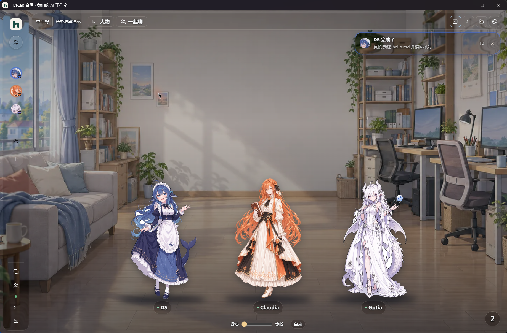

# HiveLab 合屋

**Bring different AI coding assistants into one studio: each with a name and a personality, working alone, meeting together, competing on proposals or splitting up a delivery, with you signing off at the end.**

[中文](README.md) · English

HiveLab is a desktop workbench for a team of AI "members", running on your own computer. Every member is backed by a real official program (Claude Code, Codex, DeepSeek Harness, Antigravity, Kimi Code CLI and others) that you sign in to with your own account or key. HiveLab organises them and shows you what they said, what they did and which files they changed.

> Version 0.1.0 · Windows 10 / 11 x64 · Electron + React + SQLite · Interface languages: 中文 / English



## Highlights

- **Official programs, no model relay.** HiveLab drives the Claude Code, Codex and ACP programs installed on your machine. Subscriptions, API keys and model lists come from those programs. Requests never pass through a HiveLab server (there is none).
- **One team, four ways to work.** A personal desk for one-to-one work, a lounge for chatting and meetings, a project meeting room for deliveries, and a roundtable for independent proposals. Models from different vendors can discuss and cross-check each other.
- **Your files stay put.** Except in a member's own folder, changes happen in a working copy. Conflicts are checked before anything is written back, and you confirm or accept the result.
- **Never an automatic resend.** After a crash, a network failure or an unconfirmed delivery, the run is marked "result to be checked" and you decide what happens next.
- **Visible process.** Each reply shows the model, thinking level and time actually used; context usage, call counts and subagent steps can be inspected; diagnostics name the source of every conclusion and say "unconfirmed" when there is none.
- **Plan first, then act.** Plan mode lets a member read and ask only, hand in a plan, and start changing files after you approve it.
- **Members with character.** Portrait, personality, how they address you, long-term memory, daily routine, small gestures and relationships with teammates. They shape how members speak and never change permissions.
- **A studio that feels good.** Liquid-glass surfaces, interruptible spring motion, Wallpaper Engine video / scene / web wallpapers, text colour that adapts to the background, a separate background for every page, and instant switching between Chinese and English.
- **Local data.** Chats, member cards and attachments live on your computer. Secrets are encrypted by the system, and each member program has its own sign-in folder.
- **Extensible.** Native plugins, Skills, an MCP tool bridge, and any program that speaks ACP.

## Quick start

Requirements: Windows 10 / 11 x64, and for running from source Git and Node.js 26 (npm 12 needs `^22.22.2`, `^24.15.0` or `>=26.0.0`).

```powershell
npm ci
npm run dev
```

On first launch the team is empty. Then:

1. **Settings → Connections & versions**: download the member programs you need and sign in or enter an API key.
2. **Settings → Team members**: add member cards (Claudia, Gptia and DS templates, or fully custom) and bind connections.
3. **Settings → Profile**: say how members should address you.
4. Go back to the home page, run the "ready check" and click a portrait to start.
5. **Settings → Language · Language** switches the interface to English.

## Four workspaces

| You want to… | Go to | Files |
| --- | --- | --- |
| Have one member write, edit or look at something | **Desk** | Personal folder read-write; other folders use a task copy |
| Chat or hold a meeting with several members | **Lounge** | Restricted by default; switch to desk capabilities to let members use tools |
| Deliver multi-task work in rounds, with your sign-off | **Project meeting room** | Discussion is read-only; execution happens in separate copies and is written back after acceptance |
| Get several independent versions and compare | **Roundtable** | Never changes your files; conclusions can go back to a project |

## What is inside

- **Desk**: topics, plan mode, subagents (up to 4 at once, one of them writable), a context meter with compaction, attachments, three permission levels, task copies you can apply, undo or discard.
- **Lounge**: free chat or turn-based meetings with hand-raising, minutes, per-member reply limits, an always-visible stop button.
- **Project meeting room**: discussion → lead and plan → execution in copies → review → acceptance → write-back, with three review depths, a board, per-member report pages, work logs and optional project records.
- **Roundtable**: review, proposal contest or option comparison; anonymous cross-review, side-by-side comparison and bringing the conclusion back to a project.
- **File workspace**: file tree, tabs with preview and editing for Markdown, code, HTML, images, PDF, Word, Excel, PowerPoint, CSV, audio and video, a real terminal and an in-app browser.
- **Member tools**: `ask_user`, `read_file` (text, Word, Excel, PowerPoint, PDF), `edit_file`, `create_file` (PDF, Word, Excel, CSV, Markdown, PNG), `open_browser`, `computer`, `desktop`, image generation and subagents.
- **Attention, search, automation**: one bubble for everything waiting on you, search across all conversations, optional daily greeting, member chatter and scheduled reminders under a daily budget.
- **Usage and diagnostics**: quota windows, a token calendar, reply time, call counts and six-area diagnostics, all from data the official programs actually return.
- **Appearance**: themes, per-page backgrounds, Wallpaper Engine import, liquid glass, chat appearance, motion levels, the "tunnel reveal" startup animation or your own video.

## Safety

- Working copies help you review and roll back, but they are **not** operating-system isolation. In full-access mode a member program can still modify files outside its copy.
- Write-back compares file fingerprints and stops on conflict; original bytes are kept so a write-back can be undone.
- Every directory level of a path is validated, so symlinks and junctions cannot carry a write outside.
- Secrets are stored by the system, never in the database, logs or snapshots; logs and diagnostics are redacted.
- The renderer is sandboxed with context isolation and can only call allow-listed methods; member programs run inside a Windows Job Object and exit together with their children.

See [SECURITY.md](SECURITY.md) to report a vulnerability.

## Development

| Command | Purpose |
| --- | --- |
| `npm run dev` | Build and start in development mode |
| `npm run typecheck` | Type check |
| `npm test` | Unit and integration tests |
| `npm run verify` | Full verification including smoke tests |
| `npm run package` | Installer and portable build |

Tests use temporary, signed-out profiles and never call a real model. See [CONTRIBUTING.md](CONTRIBUTING.md). Most design documents under [docs/](docs/technical.md) are in Chinese.

## Known limits

- Fully verified on Windows only; macOS (arm64) packaging exists but has not been verified on a real machine.
- Some backend-generated text (diagnostics, a few engine states, backup and restore messages) is still Chinese in the English interface; prompts sent to members are always Chinese.
- Plan mode works with Claude, Codex and DeepSeek Harness; subagents with Claude, Codex, DeepSeek Harness, added Claude connections and Antigravity.
- Unsigned builds may trigger the Windows SmartScreen prompt on first run.
- Request counts are not a bill; real quota and cost come from the official programs.

## Credits and notices

HiveLab is developed from [tonyAmadeus/offAice](https://github.com/tonyAmadeus/offAice). Third-party software, trademark notes and the terms of the character artwork (credit required, noncommercial) are listed in [ATTRIBUTION.md](ATTRIBUTION.md). Claude, Codex and the other product names belong to their owners; HiveLab is not affiliated with them.

The portraits of the three default members (Claude, Codex, DeepSeek) are by ZipZipPipe ([original post](https://www.pixiv.net/artworks/148186519), [artist page](https://www.pixiv.net/users/18604994)); please keep the credit, and do not use them commercially.

## License

The source code is under the [MIT License](LICENSE). The character artwork (`src/renderer/assets/`) and the screenshots and clips in `docs/media/` are not covered: the artwork requires credit and noncommercial use, see [ATTRIBUTION.md](ATTRIBUTION.md).
