# HiveLab 合屋

中文 · [English](README.en.md)

**把不同的 AI 编程助手请进同一个工作室：各有名字和性格，能单独干活，也能一起开会、比稿、分工交付，最后由你验收。**

HiveLab 合屋是一个运行在自己电脑上的多成员 AI 桌面工作台。每位“成员”背后都是一个真实的官方程序（Claude Code、Codex、DeepSeek Harness、Antigravity、Kimi Code CLI 等），用你自己的账号或密钥登录。HiveLab 负责把它们组织起来，并把它们说了什么、做了什么、改了哪些文件摆在你面前。

> 当前版本：0.1.0 · 平台：Windows 10 / 11 x64 · 技术栈：Electron + React + SQLite · 界面语言：中文 / English

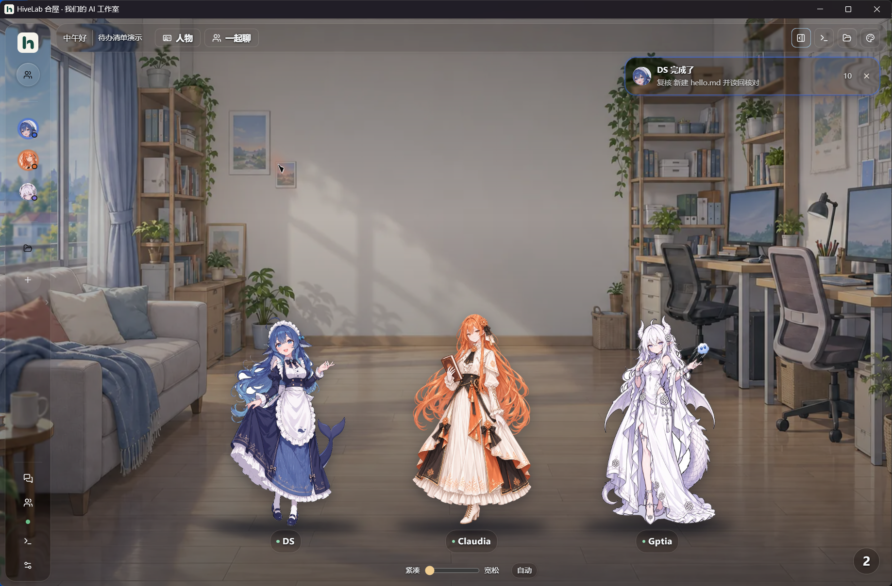

*首页：三位成员站在壁纸前。*

---

## 目录

- [项目特色](#项目特色)
- [快速开始](#快速开始)
- [界面总览](#界面总览)
- [四个协作空间](#四个协作空间)
- [首页与团队](#首页与团队)
- [成员工位：一对一干活](#成员工位一对一干活)
- [茶歇室：聊天与开会](#茶歇室聊天与开会)
- [项目会议室：分工交付](#项目会议室分工交付)
- [圆桌：比稿、评审、选方案](#圆桌比稿评审选方案)
- [人物卡、记忆与生活设定](#人物卡记忆与生活设定)
- [连接、模型与版本](#连接模型与版本)
- [文件工作区](#文件工作区)
- [成员能用的工具](#成员能用的工具)
- [待你处理、提醒与搜索](#待你处理提醒与搜索)
- [自动功能与定时任务](#自动功能与定时任务)
- [用量、额度与运行诊断](#用量额度与运行诊断)
- [插件、Skills 与 MCP](#插件skills-与-mcp)
- [外观、动效与语言](#外观动效与语言)
- [任务运行与提醒](#任务运行与提醒)
- [权限与安全](#权限与安全)
- [资料与备份](#资料与备份)
- [开发与构建](#开发与构建)
- [已知限制](#已知限制)
- [致谢与素材说明](#致谢与素材说明)

---

## 项目特色

**用官方程序，不做模型中转。** HiveLab 直接驱动你本机的 Claude Code、Codex 和各家 ACP 程序。订阅、API Key、模型清单都来自官方程序本身，请求不经过 HiveLab 的服务器（也没有这样的服务器）。

**一个团队，四种协作方式。** 一对一用工位，闲聊和开会用茶歇室，真正要交付的活用项目会议室，想要多个独立版本就用圆桌。不同厂商的模型可以同场讨论、互相复核。

**你的文件先不动。** 除成员的个人文件夹外，改文件的工作都在副本里进行。写回原文件夹之前会检查冲突，并且要由你确认或验收。

**绝不自动重发。** 程序崩溃、断网，或者无法确认一次请求有没有送达时，这次运行会标成“结果待核对”，由你决定下一步，避免重复消耗额度。

**过程摆在明面上。** 每条回复显示实际使用的模型、思考程度和耗时；上下文占用、调用次数、子代理的每一步都能查看；运行诊断说明每项结论的来源，查不到的就写“未确认”，不补造结论。

**先计划，再动手。** 工位里可以打开计划模式：成员只读、只提问，交出计划后由你批准才开始改文件。

**成员是有个性的同事。** 每位成员有自己的立绘、性格、称呼、长期记忆、作息、小动作和彼此间的关系，这些设定会影响他们说话的方式，但不会改变权限。

**一个住得舒服的工作室。** 液态玻璃材质、可打断的弹簧动效、随背景自动调整的文字颜色，每个页面都能有自己的背景，还能直接导入 Wallpaper Engine 的视频、场景和网页动态壁纸；界面可在中文和 English 之间即时切换。

**数据留在本机。** 聊天记录、人物卡、附件都存放在自己的电脑上，密钥由系统加密保存，每个成员程序使用独立的登录目录，不读取你其他软件里的账号。

**可以继续扩展。** 支持原生插件、Skills、MCP 工具桥，也可以手动接入任何支持 ACP 的程序。

---

## 快速开始

### 运行环境

- Windows 10 / 11 x64；
- 从源码运行时还需要 Git 和 Node.js（推荐 26，锁定的 npm 12 要求 `^22.22.2`、`^24.15.0` 或 `>=26.0.0`）；
- 成员程序默认使用 HiveLab 自带的运行环境，无需另装 Node.js；部分程序需要联网登录，界面会给出提示。

### 从源码运行

```powershell
npm ci
npm run dev
```

也可以双击根目录的 `Start-HiveLab-Dev.cmd`，它每次都会先构建最新代码再打开窗口。开发版的资料放在项目内的 `.hivelab`，和日常版分开。

### 第一次使用

新资料从空白团队开始，不会预装成员，也不会探测你没有配置过的程序。

1. 打开 **设置 → 连接与版本**，从清单下载需要的成员程序，并完成登录或填写 API Key。
2. 打开 **设置 → 团队成员**，添加人物卡并绑定连接。可以选用 Claudia、Gptia、DS 的形象模板，也可以完全自定义。
3. 打开 **设置 → 个人资料**，写上成员该怎么称呼你。
4. 回到首页：没有可见人物且仍有未完成事项时，会显示“开工前检查”；人物显示后，可在 **设置 → 连接与版本** 查看连接状态。点击立绘即可开始对话。
5. 想用英文界面，到 **设置 → 语言 · Language** 切换，立即生效。

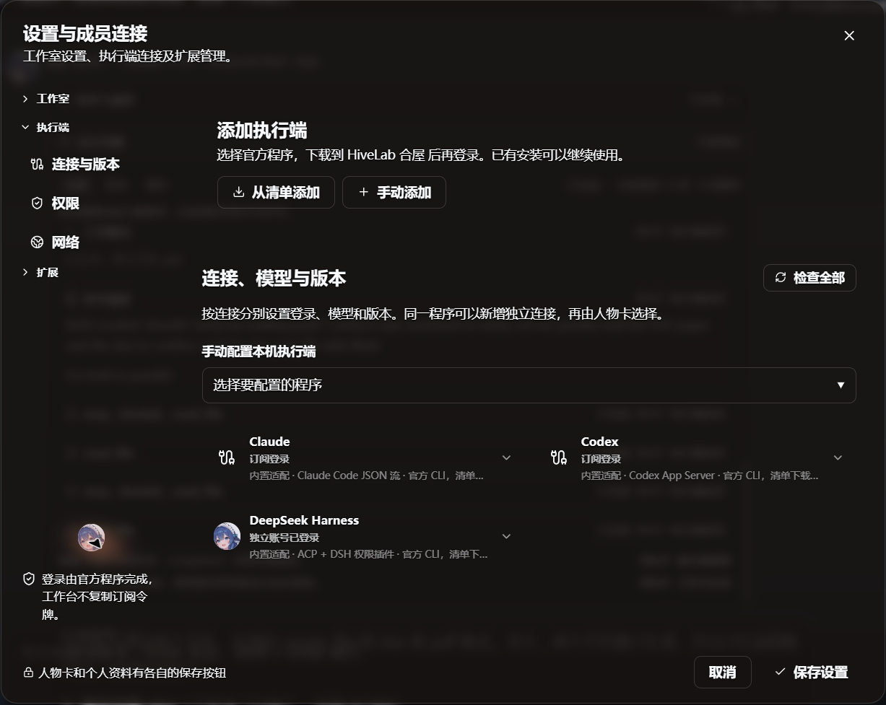

*连接与版本：成员程序清单与连接详情。*

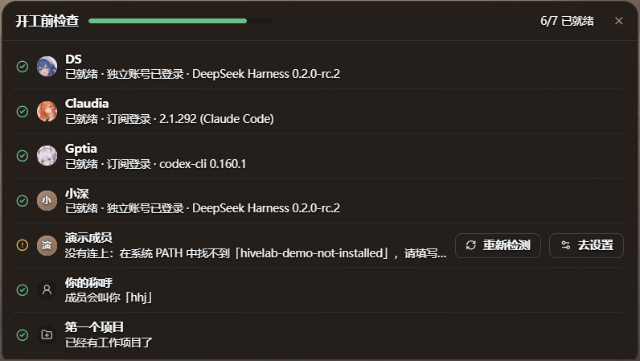

*开工前检查：已就绪和未连接的示例状态。*

关闭窗口后程序会留在托盘。托盘菜单提供“打开工作台”“停止所有成员”和“退出 HiveLab 合屋”。

---

## 界面总览

| 区域 | 内容 |
| --- | --- |
| 左侧栏 | 分“工作台”和“文件”两页。工作台里有团队、项目、茶歇室、圆桌、终端和设置，可收起为图标，宽度可拖动 |
| 顶部右侧 | 文件预览、终端、文件、外观四个常驻入口；聊天页面下方另有搜索栏 |
| 主区域 | 当前页面：首页、工位、茶歇室、圆桌、项目会议室、成员汇报 |
| 右侧分栏 | 子代理、文件预览、搜索结果和应用内浏览器，与聊天并排显示，从左到右依次排列 |
| 底部分栏 | 工作区终端（快捷键 ``Ctrl+` ``） |
| 右下角 | “待你处理”气泡，汇总所有等你决定的事 |

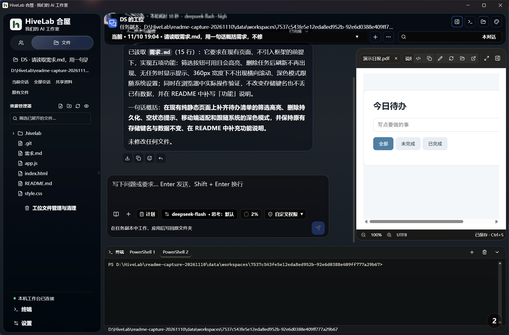

*界面总览：文件侧栏、对话、预览和终端。*

### 设置一览

左侧栏的“设置”分三组，每一页的作用如下。

| 分组 | 页面 | 内容 |
| --- | --- | --- |
| 工作室 | 团队成员 | 添加、编辑人物卡，绑定连接 |
| | 人物设定 | 所有成员的性格、人设和说话风格，保存为一份 Markdown 文件 |
| | 个人资料 | 成员怎么称呼你 |
| | 外观 | 主题、背景与动态壁纸、液态玻璃、聊天外观、动效、启动动画 |
| | 语言 · Language | 中文 / English |
| | 工作台 | 提醒、并行任务数、任务时限、新会话权限、执行端运行环境 |
| | 存储 | 空间占用、清理、资料备份与恢复 |
| | 工作公约 | 全体成员共同遵守的规则 |
| 执行端 | 连接与版本 | 成员程序的下载、登录、版本和模型 |
| | 权限 | 三档权限及按人物的覆盖 |
| | 网络 | 系统 TUN 或显式代理，npm 下载源 |
| 扩展 | 插件 / Skills | 内置与本地插件、原生插件、插件市场、Skills |

---

## 四个协作空间

| 你想…… | 去哪里 | 文件怎么处理 |
| --- | --- | --- |
| 让某位成员写段文字、改个文件、看张图 | **成员工位** | 个人文件夹直接读写；其他文件夹使用任务副本 |
| 让几位成员一起聊聊、开个会、拿个主意 | **茶歇室** | 默认受限；切到工位能力后沿用各成员的工具 |
| 交付一个有多项任务的活，分轮完成，由你验收 | **项目会议室** | 讨论只读；执行在独立副本里进行，验收后写回 |
| 让几位成员各写一版，比较后再选 | **圆桌** | 不改你的文件；结论可以带回项目 |

---

## 首页与团队

首页是团队的“合影”：所有成员的立绘站在你选的背景前。

- **左键**点击立绘进入 TA 的工位；**右键**（或菜单键、Shift+F10）打开人物资料卡。
- **长按拖动**立绘可以调整站位，两位成员互换位置。
- 底部滑杆调节人物疏密，“自动”恢复默认；人多放不下时可以左右翻看。
- 人物卡填写身高后，立绘会按比例体现高矮差异。
- 每位成员显示当前状态：正在工作时显示实际任务，空闲时显示作息和小动作（这些只是设定，不代表真实工作）。
- 点击首页的“请大家一起来”可以直接把大家叫进会议室。

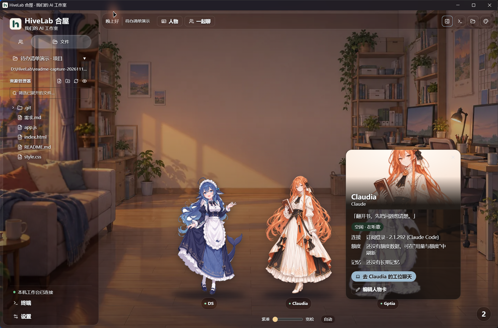

*首页：右键立绘打开人物资料卡。*

[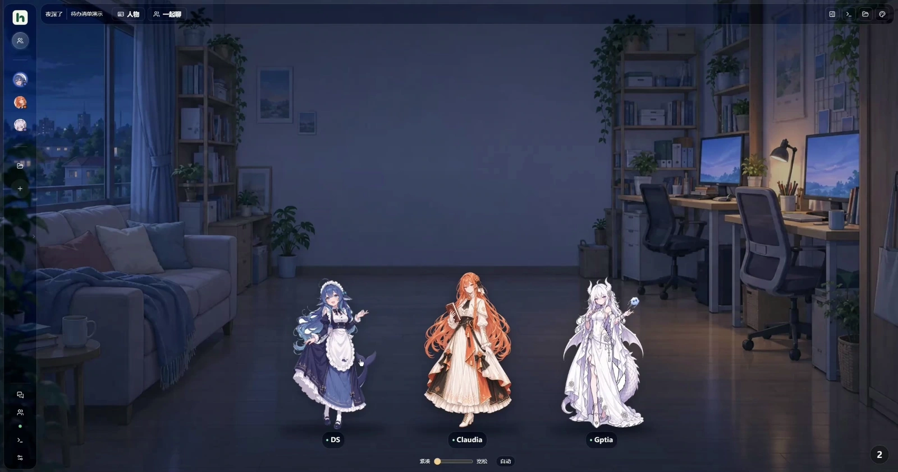](docs/media/v05-standee-drag.mp4)

*首页立绘：悬停浮起，长按拖动换位。· [查看高清 MP4](docs/media/v05-standee-drag.mp4)*

---

## 成员工位：一对一干活

每位成员有自己的工位，是最快的使用方式，不走任何流程。

**话题。** 点击“开新话题”直接开始，第一句话的前 20 个字会自动成为标题，手动改过的标题不会被覆盖。旧话题归档后随时能翻回去，也可以导出或压缩。

**工作文件夹。** 工位标题持续显示实际工作位置和“直接读写 / 任务副本 / 只读”状态。

- **个人文件夹**：成员的私人空间，改动直接保存。每个新话题有独立目录。
- **其他文件夹**（比如你的项目）：成员在任务副本里修改，原文件夹不动。

副本完成后，你有三个选择：

| 选项 | 作用 |
| --- | --- |
| 应用到原文件夹 | 把改动写回原文件夹，写回前检查冲突 |
| 撤销最近一轮 | 恢复到这一轮开始前的样子，已写回的原文件也一起恢复 |
| 丢弃工作副本 | 放弃这份副本的所有改动 |

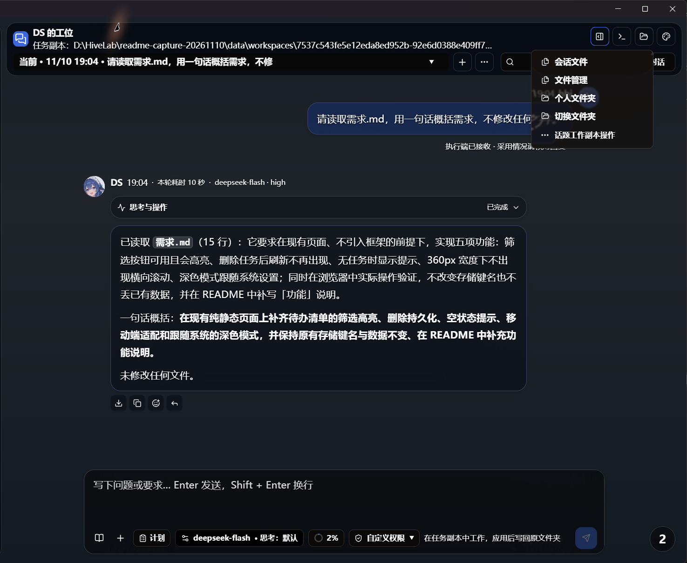

*文件菜单中的“话题工作副本操作”入口。*

**模型、思考程度和权限。** 输入框旁可以为当前话题单独选择模型和思考程度，从下一轮生效；成员权限可以在“完全访问 / 帮我批准 / 请求批准”之间切换。

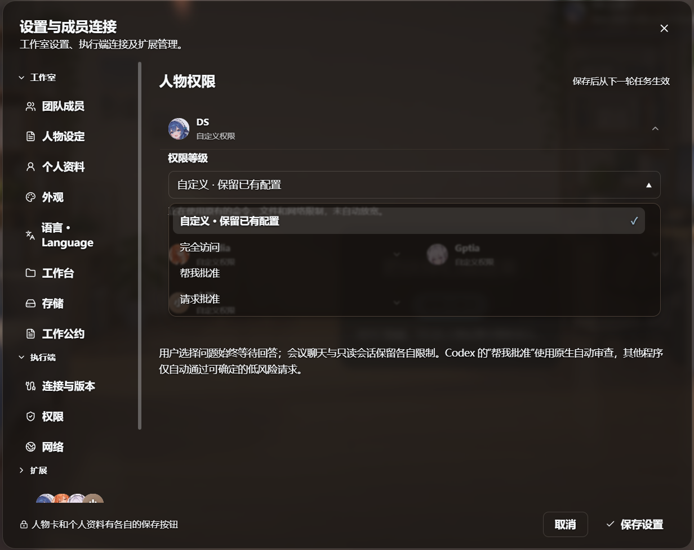

*三档权限：完全访问 / 帮我批准 / 请求批准。*

**附件。** 可以点“+”、拖入或粘贴图片和文件。输入框里的文字、附件和回复对象按话题自动保存，切换页面或重启后都还在。Enter 发送，Shift+Enter 换行，`@` 选择成员。

**过程可见。** “思考与操作”展示成员的思考、工具调用和命令结果，回复旁标出这一轮实际使用的模型和耗时。回复可以复制、导出、加表情回应或单独引用。成员列出任务清单时，清单会随进度更新。

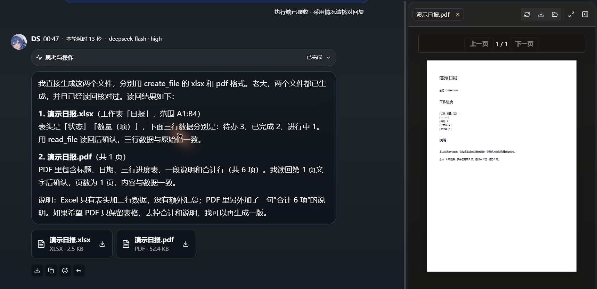

*工位对话：展开“思考与操作”，回复旁标出实际模型与耗时。*

### 计划模式

适合改动较大、想先看方案的任务。Claude、Codex 和 DeepSeek Harness 的工位话题支持。

1. 点输入框下方的“计划”开关，提示栏显示“先拟定计划，你批准后再动手”。
2. 发送任务。成员这一轮只读文件、搜索和提问，不改文件，最后交出计划。
3. 回复下方出现“计划”卡片：**按计划执行**让成员开始动手并自动关闭开关；**修改计划**展开意见框，写下意见后成员按意见重新拟定。
4. 话题里有了更新的对话后，旧计划会标为“已失效”，不能再批准。

开关保存在话题上，重启后仍然有效。茶歇室、项目会议室和自动发言不会进入计划模式。

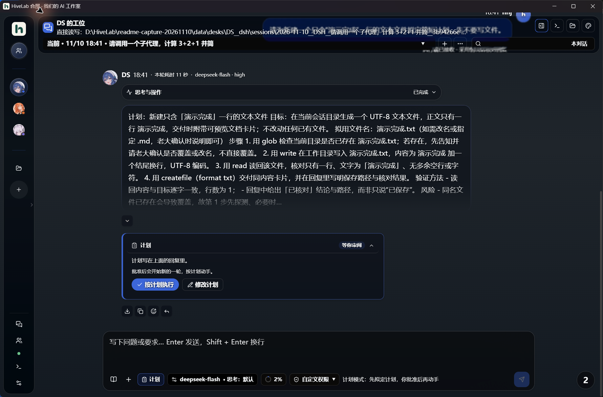

*计划模式：审阅计划，再选择执行或修改。*

### 上下文占用与压缩

输入框下方、模型按钮右边有一个小圆环和百分比，表示这个话题最近一轮占用了多少上下文，超过 70% 变黄，超过 90% 变红。点圆环打开“上下文”面板：

- 已用百分比、已用 / 上限和分段条；
- 各部分占用：对话消息、执行端系统提示与工具、HiveLab 工具、人物设定与工作公约、Skills 索引、记忆文件、自动压缩缓冲和剩余空间；
- “压缩会话”按钮，可以写一句“压缩时重点保留什么”；
- 上下文上限（可写 `400k`、`1M`、`20万` 这类写法，不能超过模型自带的上限）和自动压缩点（60%–90%）。

保存后从下一轮开始生效，并记为这位成员新话题的默认值。官方程序没有给出的数据显示“—”，不做估算。

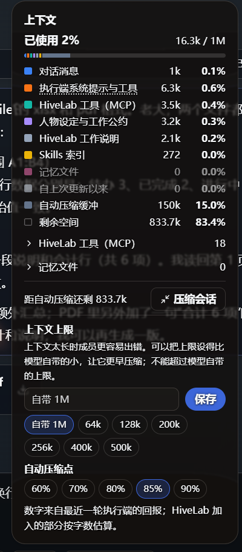

*上下文面板：占用分段、上限和自动压缩点。*

### 子代理

主代理遇到可以拆开的工作时，可以派出子代理并行处理。Claude、Codex、DeepSeek Harness、添加的 Claude 连接和 Antigravity 支持，只在工位对话和项目任务里可用。

- 子代理不带人物设定和工作公约，只收到主代理写的任务说明；用什么模型和思考程度由主代理按任务决定。
- 默认只读；每个主任务最多同时 4 个子代理，其中能写文件的最多 1 个。
- 需要批准的操作会进入主对话的确认栏，标题前标明“子代理 #n”。
- 回复上方显示子代理卡片（标题、状态、模型、用时、最近一步）；点开右侧的“子代理”侧栏可以看完整过程和结果。
- 主代理结束或被停止时，仍在运行的子代理会一并停止。

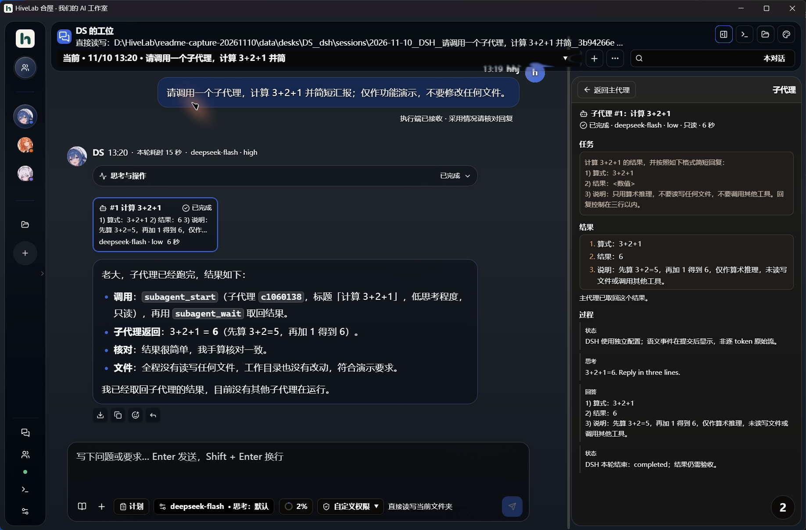

**工位文件管理。** 文件树分“当前会话 / 全部会话 / 共享资料 / 原有文件”，清理时先预览再移入回收区（默认保留 7 天），运行中的文件受保护，恢复时不会覆盖同名文件。

---

## 茶歇室：聊天与开会

茶歇室是大家的公共空间。先在顶部选择谁在场，再选择聊天方式。

**闲聊。** 成员根据内容自然接话，你可以随时插话，`@名字` 指定优先接话的人。成员向你提问时不会卡住讨论，问题会留着等你有空回答。

**开会。** 成员按在场顺序轮流发言，然后等你。

- **举手模式**：一轮结束后，想补充的成员举手；也可以设成由你点名。
- **整理会议纪要**：选一位成员写出结论、分歧和下一步，会议随之结束。纪要只列本次参会的人。

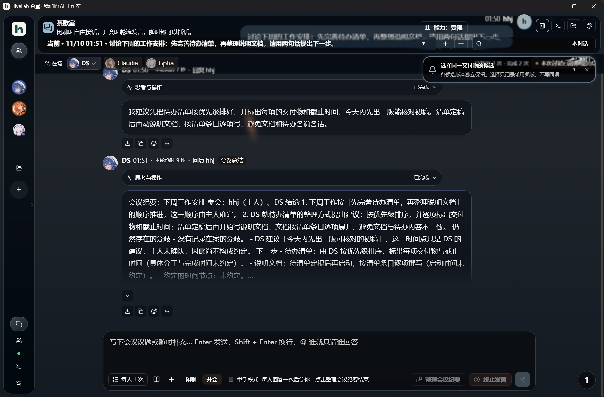

*茶歇室：选择在场成员、会议与举手模式。*

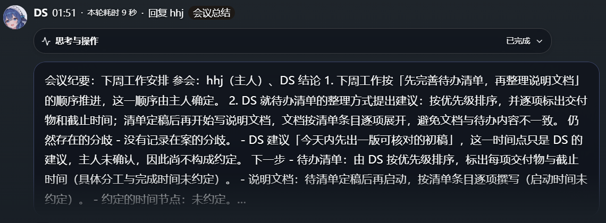

**发言次数。** 发送区可以设置本条消息每人的回复次数（0–100 或不限），也可以给成员分别设置。次数由程序逐人计数，成员的回复无法绕过。

**终止发言。** 按钮始终可见，会停止本房间当前的发言并撤回排队中的发言，其他工位的任务不受影响。

**能力开关。** “能力：受限 / 能力：工位”决定普通聊天能否使用工具。默认受限，切到工位能力后，成员沿用各自的执行端、工具、插件和权限模式，可以在讨论中处理文件和命令。

**话题管理。** 话题太长时可以压缩上下文（原消息保留）；开新话题时可以把旧话题的摘要带过去；也可以导出为 Markdown。

**生成图片。** 使用 Codex 的成员可以按要求生成图片，图片下方提供“修改这张图”继续调整。

---

## 项目会议室：分工交付

适合多任务、分轮次、需要验收的工作。在左侧“项目”栏添加一个文件夹，或从首页点“请大家一起来”，选好成员后进入。

### 一个项目的六步

1. **讨论**：在聊天里说清楚要做什么。成员可以只读查看项目文件核实现状，但不能修改。
2. **定负责人**：选一位成员起草方案。
3. **方案**：负责人写明交付物、完成标准、轮次和分工。你点“确认方案，开工”，或者点“要改一下”。
4. **执行**：每项任务在独立副本里进行，你的原文件夹在验收前不会变。
5. **验收**：每轮结束后查看成品和改动，选择通过或驳回。
6. **完成**：通过后成品写回项目文件夹，并生成整段工作总结。想继续就点“开始新的一段工作”。

开始下一轮前可以写附言，它会作为补充要求进入这一轮的任务和检查。

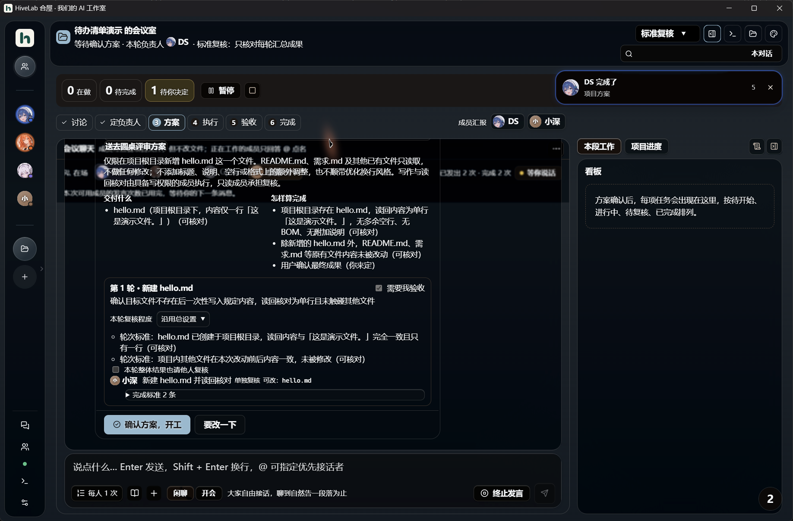

*项目会议室：进度条停在“方案”，确认方案或要求修改。*

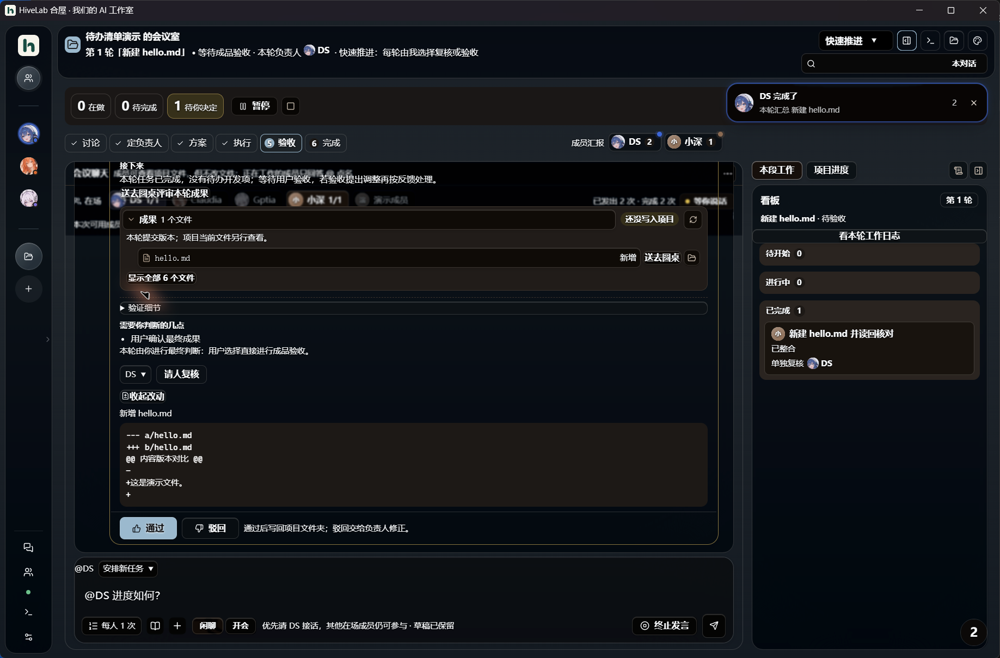

*验收：查看成品文件和改动，选择通过或驳回。*

### 复核程度

| 选项 | 检查范围 | 适合 |
| --- | --- | --- |
| 深入复核 | 每项任务和每轮成果都有其他成员检查 | 重要的活，调用次数多 |
| 标准复核 | 只检查每轮的汇总成果 | 大多数情况 |
| 快速推进 | 每轮由你决定要不要复核 | 简单的活，最省调用 |

无论选哪种，最后都由你验收。

### 工作中的常用操作

- **下一步按钮**：页面始终提示你现在该做什么，点击后跳到对应的卡片。
- **@ 正在干活的成员**：可以选“只是问问”（不影响任务）、“安排新任务”（由负责人补全后你确认）或“补充到 TA 当前的任务”（运行中送达，并显示回执）。
- **暂停 / 继续**：暂停后正在做的任务会做完，但不再派发新任务。
- **成员汇报**：每位成员有自己的汇报页，在这里提问时成员只读回答，不会改文件。
- **看板与项目进度**：按待开始、进行中、已完成列出任务，可以查看历次工作、任务详情和日志，并导出汇报。
- **工作日志与项目记录**：每位成员的每一步都能在“工作日志”里查看，并导出；可选开启“验收写回后自动保存日志”，日志写在项目的 `.hivelab/logs/`。另可开启“项目记录”，每段工作完成或取消后，根据保存的方案、汇报、验收和决策新建一份记录文件，不覆盖已有文件。两项默认都是关闭的。
- **额度用完**：任务暂停并显示预计恢复时间，到点后点“接着做”，沿用原会话，不自动重发。
- **需要亲手验证的标准**：成员没有浏览器或真机时，“双击能用、刷新后还在”这类检查会转入你的验收清单。

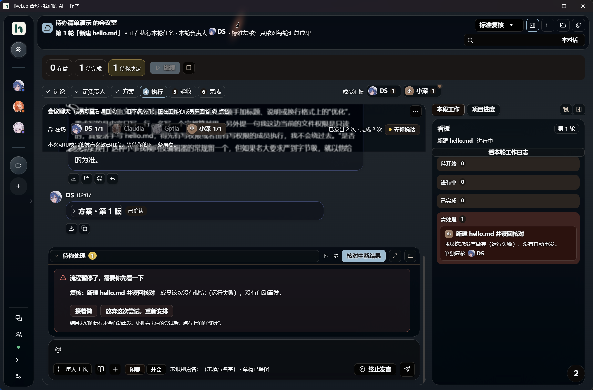

*项目看板：按待开始、进行中、已完成和需处理查看任务。*

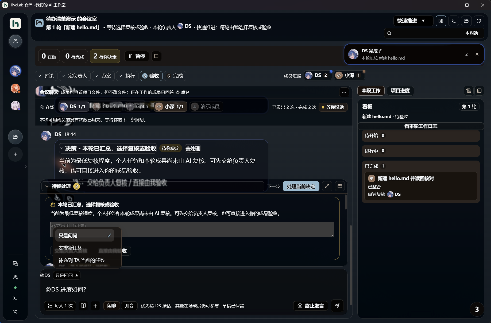

*点名成员：选择只是问问、安排新任务或补充当前任务。*

---

## 圆桌：比稿、评审、选方案

适合“我想要几个版本，比一比”的场合，不需要建项目。

1. 开新议题，选择类型：**评审**（各自检查同一份材料）、**比稿**（每人独立写一版）或**方案比较**（每人提一个方案）。
2. 写下要求或拖入材料，选择参加成员和汇总成员。
3. **各自准备**：成员独立工作，公开前互相看不到。
4. **公开与互评**：互评时候选匿名，用字母代替，每位评审者看到的顺序各不相同，汇总者也看不出作者。
5. **审议讨论**：大家就意见讨论，每人发言一次后等你。
6. **并排对比**，在想要的版本上点“采用此候选”。
7. 整理会议纪要并确认结论。
8. 需要时点“带回项目”，结论会作为材料进入项目接下来的方案或轮次，每份只用一次。

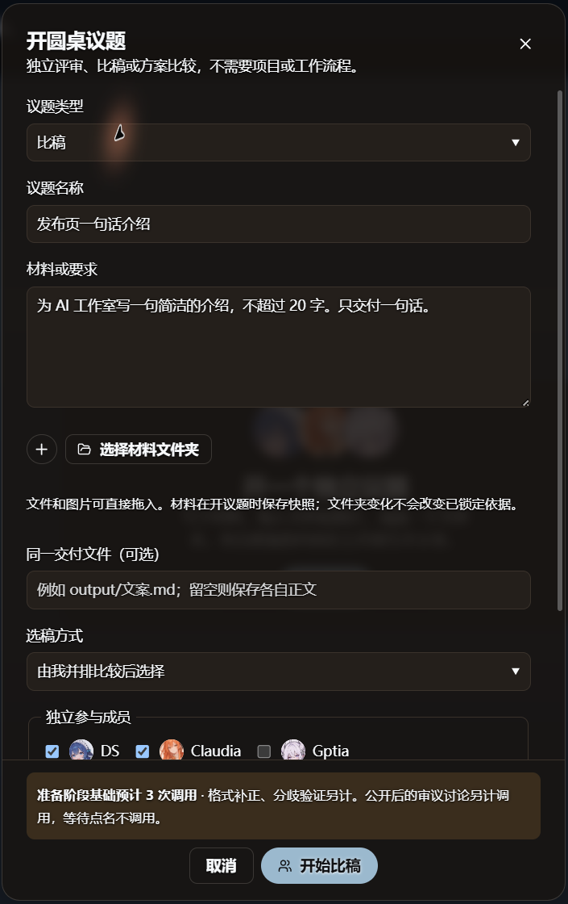

*圆桌：开新议题，选择评审、比稿或方案比较。*

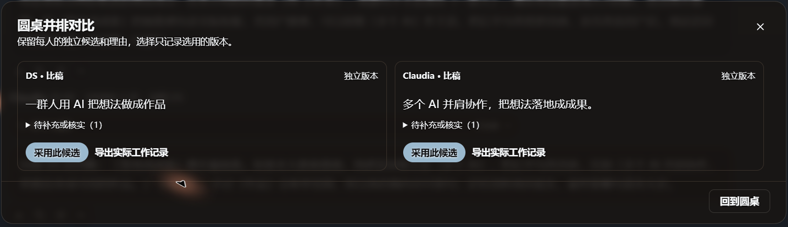

*圆桌并排对比：采用其中一份候选。*

---

## 人物卡、记忆与生活设定

人物卡和底层程序相互独立。换绑连接只影响新话题，旧话题保留原来的执行端和聊天记录。

| 项目 | 说明 |
| --- | --- |
| 形象 | 头像、立绘、特征色、身高、座右铭；立绘可以淡化浅色底 |
| 性格 | 人设文字每轮都会交给成员；还可以设置健谈程度和对你的称呼 |
| 长期记忆 | 逐条管理，每条可以单独开关，并标明来源（手写、导入、成员提议）；可从本机的 Codex、Claude 桌面端记忆导入 |
| 生活设定 | 早上、白天、傍晚、深夜的作息，闲暇时的小动作，和其他成员的关系 |
| 模型配置 | 按话题、人物卡、全局设置依次取值 |

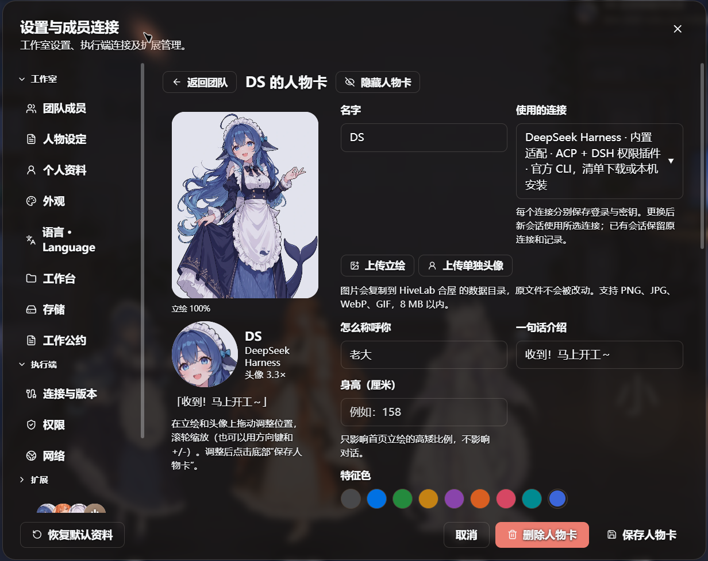

*人物卡：设置成员形象、连接和对你的称呼。*

设定只影响成员的表现，不改变权限。

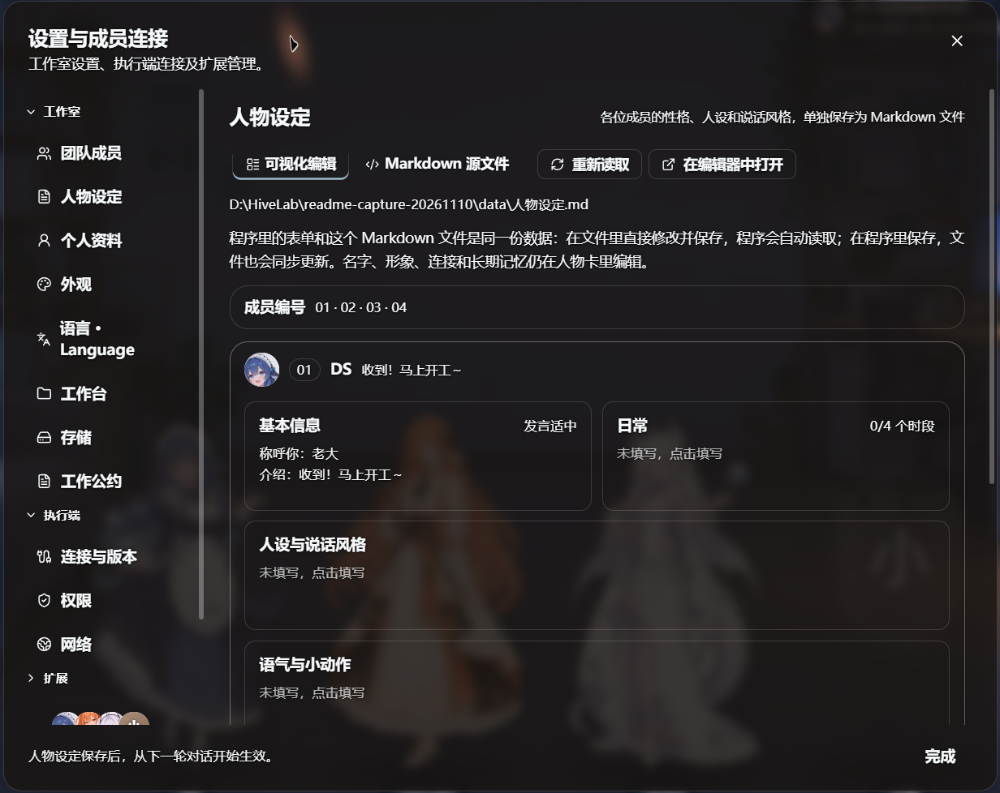

*人物设定：查看称呼、日常和说话风格等选项。*

**人物设定。** **设置 → 人物设定** 把各位成员的性格、人设和说话风格集中保存成一份 Markdown 文件，方便整体修改和备份。每位成员有编号（如 01、02），关系写作“02（Sol）”这样的形式。设定分两层：身份、性格、分工等只由你修改；“语气与小动作”（口癖、随身小物、习惯）成员可以自己微调，但成员无法改动人设、名字、关系和健谈程度。保存后从下一轮对话开始生效，已有的原生会话会在下一轮补发最新设定。

**工作公约。** 在 **设置 → 工作公约** 编辑全体成员共同遵守的规则，支持预览、插入条目和在外部编辑器中打开。保存后从下一轮任务开始加载，所有执行端都能收到。

---

## 连接、模型与版本

### 支持的成员程序

| 程序 | 登录方式 | 接入方式 |
| --- | --- | --- |
| Claude Code | 官方订阅登录；Anthropic API Key（可填写兼容 Messages API 的 HTTPS 地址） | 原生 stream-json |
| Codex | ChatGPT 官方登录 | app-server JSON-RPC |
| DeepSeek Harness | DeepSeek 官方账号登录 | ACP |
| Antigravity | Google 官方账号登录（官方发行包，校验 SHA-256 与签名） | ACP |
| Kimi Code CLI | 会员登录；Moonshot 开放平台 API Key；Kimi Code 会员 Key | ACP |
| ZCode CLI（GLM） | BigModel / Z.ai 官方账号登录；GLM API Key | 专用适配器 |
| Qoder / Qoder CN | 官方账号登录；个人访问令牌 | ACP |
| Qwen Code | 兼容 API Key | ACP |
| OpenCode | Go 订阅；Kimi、GLM、MiniMax 等 Coding Plan；OpenCode Zen；xAI、MiniMax、Anthropic、OpenAI API Key | ACP |
| Cursor CLI | Cursor 官方账号登录 | ACP |
| Gemini CLI | Google 官方浏览器登录；Gemini API Key（需自行安装，不在下载清单里） | ACP |
| 其他 ACP 程序 | 手动填写启动命令接入 | ACP |

### 连接管理

- **多个独立连接**：同一个程序可以建多个连接，例如“智谱 API”和“智谱 Coding Plan”。各连接的登录方式、密钥、模型和额度互相隔离，程序文件共用。多张人物卡也可以共用一个连接。
- **版本管理**：成员程序下载到本地，可以检测更新、切换和清理版本。旧版本保留用于回退，正在使用的版本不能删除。启动后及每 6 小时检测一次更新，由你点击安装。
- **模型选择**：模型清单来自官方程序或服务接口，也可以手动填写 API Model ID。Kimi、GLM 的 API 连接可以不设默认模型，改在话题里选择。
- **账号隔离**：每个程序的登录目录由 HiveLab 单独管理，启动时会清除宿主环境里的 `CLAUDE*`、`ANTHROPIC*`、`CODEX*`、`OPENAI*` 等变量。
- **网络**：在 **设置 → 网络** 选择沿用系统 TUN 或显式代理，工作台启动的成员程序都走所选出口。HiveLab 不修改系统代理、DNS、防火墙或网卡，也不申请管理员权限。
- **下载源**：成员程序默认从 npm 官方源下载，国内网络可切换到 npmmirror 镜像；镜像下载仍与官方包名及完整性记录核对。
- **运行环境**：在 **设置 → 工作台 → 执行端运行环境** 里默认使用 HiveLab 自带的运行环境，无需另装 Node.js；DeepSeek Harness 的原生加载器不兼容时，才使用经校验的官方便携备用环境。

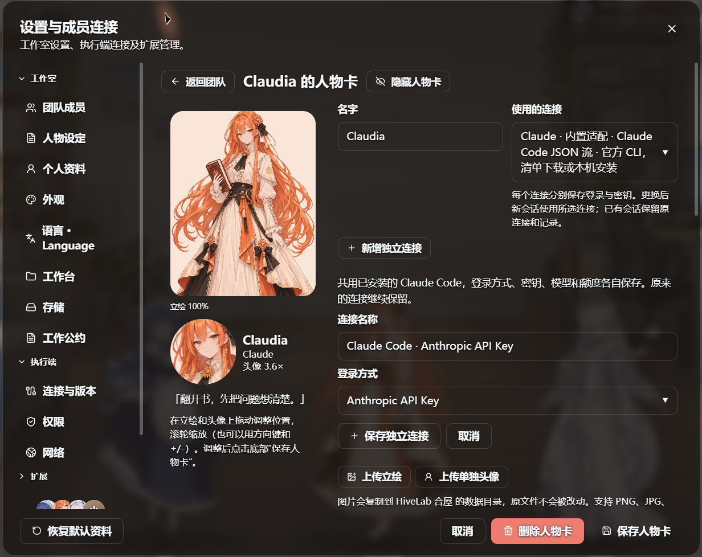

*为同一个程序新增独立连接。*

---

## 文件工作区

左侧栏切到“文件”，可以浏览项目、成员个人文件夹、工位当前文件夹、任务副本，或打开其他文件夹。切换时不会关闭对话。

**文件树。** 支持新建、重命名、复制相对路径、在资源管理器中显示、移入系统回收站。

**预览与编辑。** 单击文件在右侧标签页打开，每个标签可以缩放（50%–400%）。

| 类型 | 支持情况 |
| --- | --- |
| Markdown、文本、代码 | 语法高亮、预览 / 源码切换，可编辑，Ctrl+S 保存；保留原编码和换行符，磁盘文件变化时提醒冲突 |
| HTML | 在沙箱中渲染网页，支持同目录资源，可切换源码 |
| 图片 | 常见格式及 AVIF、SVG；放大后可拖动查看 |
| PDF、Word（DOCX） | 内置预览 |
| Excel（XLSX）、PPT（PPTX） | 分别以表格和文字预览，不等同于完整 Office 排版 |
| CSV / TSV | 表格视图，可查看源码 |
| 音频、视频 | 内置播放器，实际可播放的格式取决于编码 |

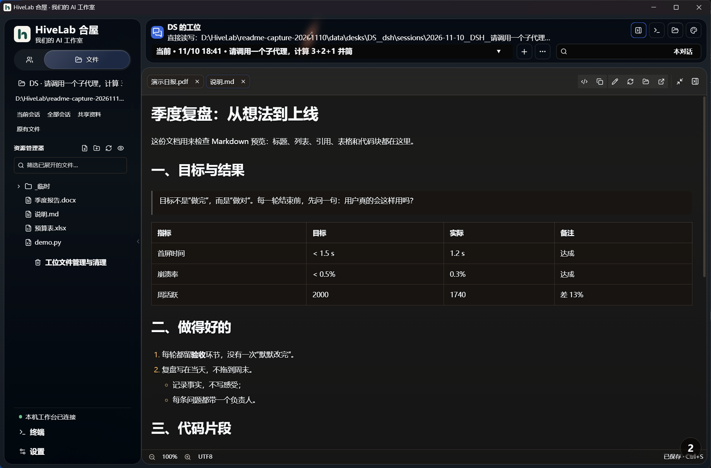

*文件预览：Markdown 与代码，玻璃材质的引用、表格和代码块。*

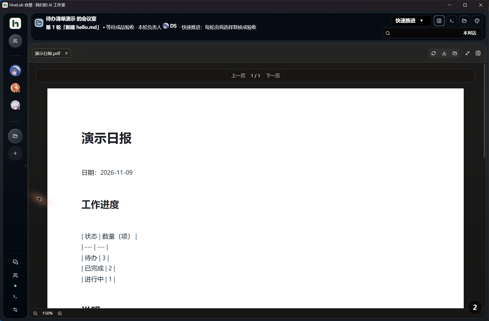

*内置预览的格式：Word、Excel、PowerPoint、PDF。*

**工作区终端。** 真实的本地终端，Windows 下使用 PowerShell。支持多个终端、交互输入和拖动调整高度，收起面板时进程继续保留。

**应用内浏览器。** 成员可以把网页打开在右侧分栏，和对话并排查看。

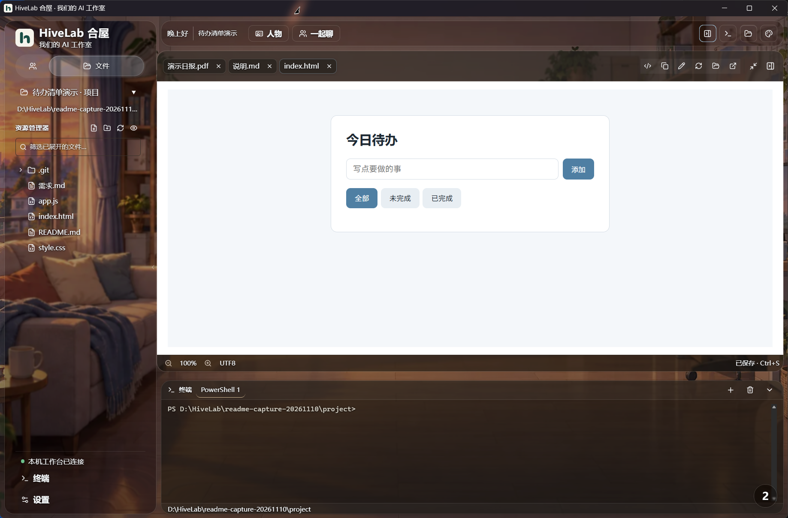

*网页预览与工作区终端同屏。*

---

## 成员能用的工具

除了各程序自带的能力，HiveLab 还通过内置插件为成员提供这些工具，所有执行端共用：

| 工具 | 作用 |
| --- | --- |
| `ask_user` | 向你显示选择题并等待回答，任务会暂停等你提交 |
| `read_file` | 读取已授权目录中的文本、代码、Word、Excel、PowerPoint 和 PDF。表格按工作表和行范围分段，PDF 可按页读取，也可把指定页渲染成图片；一次最多返回约 12 万字，超出时给出继续读取的参数 |
| `edit_file` | 修改 UTF-8 文本和 Word 正文；生成副本并保留原文件，其他格式会明确拒绝 |
| `create_file` | 生成 PDF、Word、Excel（多工作表，支持公式、日期、百分比）、CSV、Markdown、文本、代码或 PNG 文件，自动附到回答中 |
| 子代理工具 | 派出、等待和停止子代理，见[子代理](#子代理) |
| `open_browser` | 在应用内浏览器打开网页 |
| `computer` | 截取主屏幕并操作鼠标键盘。一次只有一个任务能持有操作权，非完全访问模式首次使用要你授权，顶部提示条可随时停止 |
| `desktop` | 读取 Windows 窗口里的按钮、输入框等控件并点击、填写、选择，不截图、不动鼠标，但目标窗口可能被带到前台。和 `computer` 共用操作权，单独授权，同样显示顶部提示条 |
| 原生生图 | 使用 Codex 成员生成和修改图片 |

这些工具都可以在 **设置 → 插件** 中单独停用。


*成员生成的 Excel 与 PDF 文件附在回答里，点开即可预览。*

---

## 待你处理、提醒与搜索

**待你处理。** 右下角的气泡汇总所有等你决定的事：成员在等回答、操作等确认、结果待核对、成员需要登录、成品等验收。点一项就跳到对应的位置。

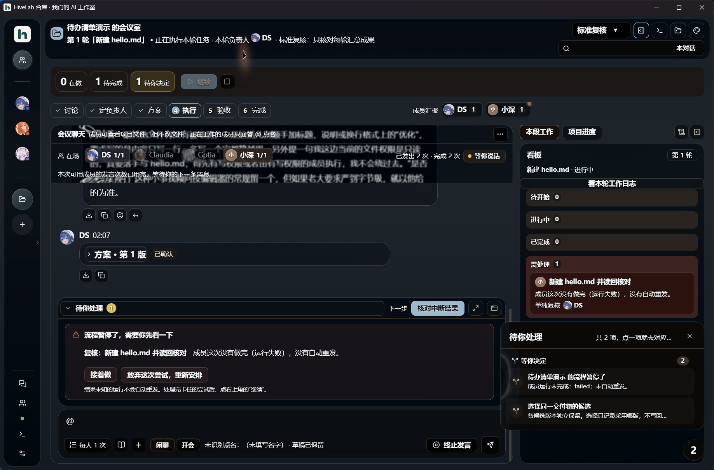

*“待你处理”：所有等你决定的事汇总在一处。*

**消息提醒。** 成员完成任务、提问、请求授权、运行失败时都会提醒你。应用在前台时显示可点击的消息卡片，在后台时发送系统通知。重启和恢复资料时不会重播历史提醒。

**会话搜索。** 可以搜索“本会话”或“全部会话”，范围包括工位、茶歇室、圆桌、项目会议室和成员汇报。结果显示在独立分栏，点击后定位到对应消息。

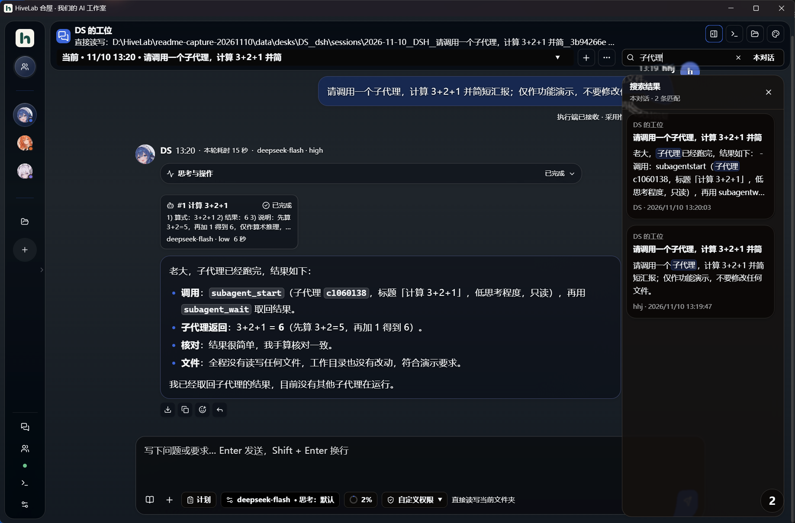

*会话搜索：结果显示在独立分栏。*

---

## 自动功能与定时任务

团队栏的时钟按钮打开自动功能。所有自动发言都是**可选开启**的，并受每日预算限制。

| 功能 | 说明 |
| --- | --- |
| 每日开场 | 每天第一次打开窗口时发言一次，重启或回拨时钟不会重复触发 |
| 成员闲聊 | 按设定间隔（5–1440 分钟）在茶歇室聊两句 |
| 定时任务 | 每天、一次或固定间隔触发；可以让成员发言（使用每日预算），也可以只发本地提醒（不用成员额度） |

程序关闭期间错过的任务不会补发。自动功能可以整体暂停。

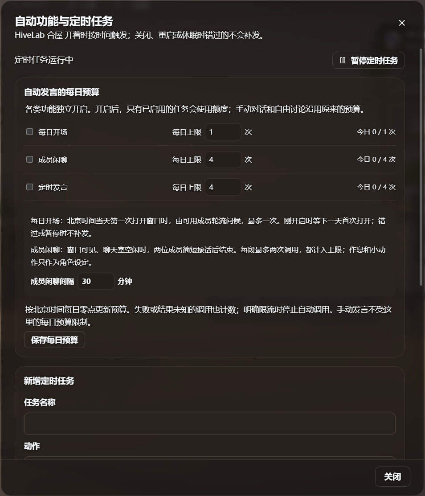

*自动功能：每日预算与定时任务。*

---

## 用量、额度与运行诊断

- **用量与额度**：显示各成员的额度窗口和账户余额，可以一键刷新。额度和费用只显示官方程序实际返回的数据。
- **Token 活动**：按日历汇总过去一年的 Token，并单独列出订阅用量和各执行端明细。官方程序没有提供的数据显示“未提供”，不做推算。
- **回复耗时**：每条回复显示本轮耗时，包含准备、排队、工具执行和等待确认的时间。
- **调用次数**：分别显示累计尝试、已发出、已完成，未发出、撤回和结果未知单独列出。次数不等同于账单。
- **上下文占用**：见[上下文占用与压缩](#上下文占用与压缩)。
- **运行诊断**：从程序与连接、账号、会话与配置、任务投递、工具权限、技能与 Hook 六个方面展示证据。查询本身不调用模型，也不改变任何状态。

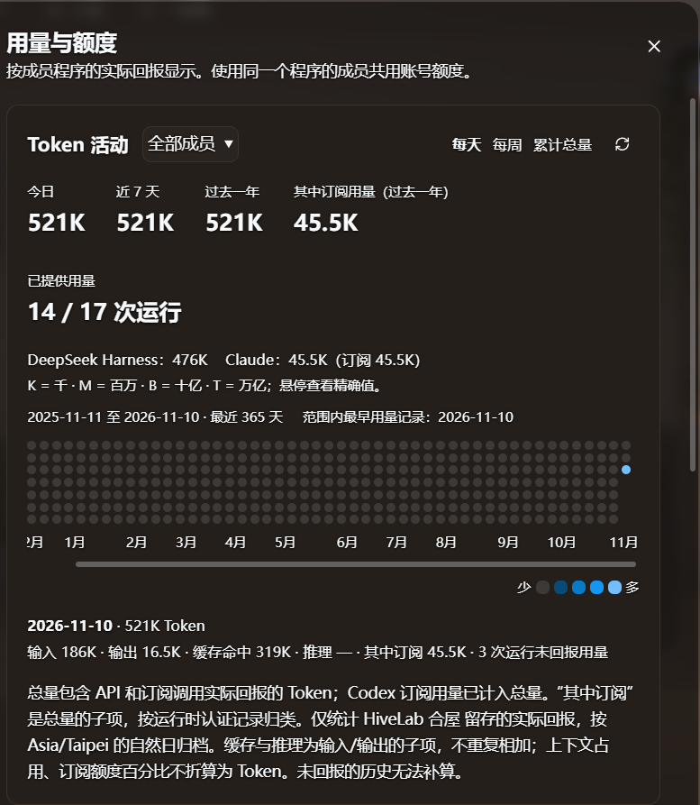

*用量与额度中的 Token 活动日历。*

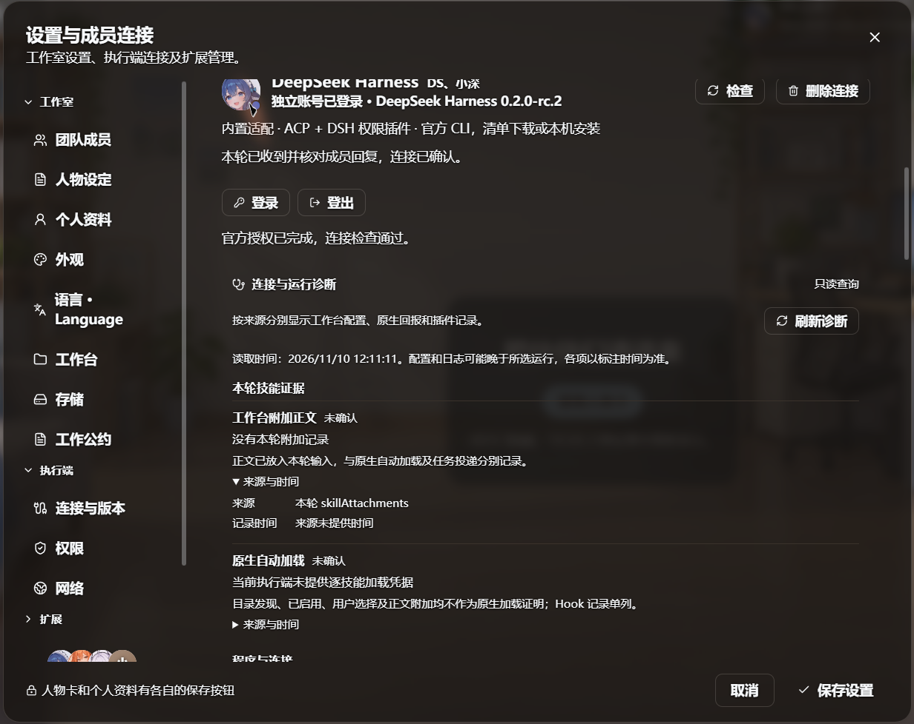

*运行诊断：每项结论都标明来源。*

---

## 插件、Skills 与 MCP

入口在 **设置 → 插件 / Skills**。

**HiveLab 插件。** 随程序安装 9 个内置插件：工作室协作、交互确认、文件读取编辑与交付、电脑操作、界面元素操作、原生生图、文件与图片预览、每日用量、页面背景。也可以安装 `hivelab-plugin.json` 格式的本地插件，带脚本的插件需要勾选信任。

**原生 Agent 插件。** 用各程序自己的安装器管理 Codex、Claude Code 和 DSH 的插件。来源可以是本地目录、公开 GitHub 仓库，DSH 还支持 npm 包。安装前先看预览，成员工作期间不允许修改。

**插件市场。** 搜索 Codex 原生市场和 DSH 社区索引，并能检测来源里可共享的 Skill 和 MCP 接口。

**Skills。** 按 Codex、Claude Code、DSH、HiveLab 通用分组管理。Codex 技能直接读取原生列表，并支持安装、启停和卸载（卸载时归档，可恢复）。发送消息时可以指定本轮使用的技能，运行诊断会区分“用户选择”“按需读取”和“原生加载”。

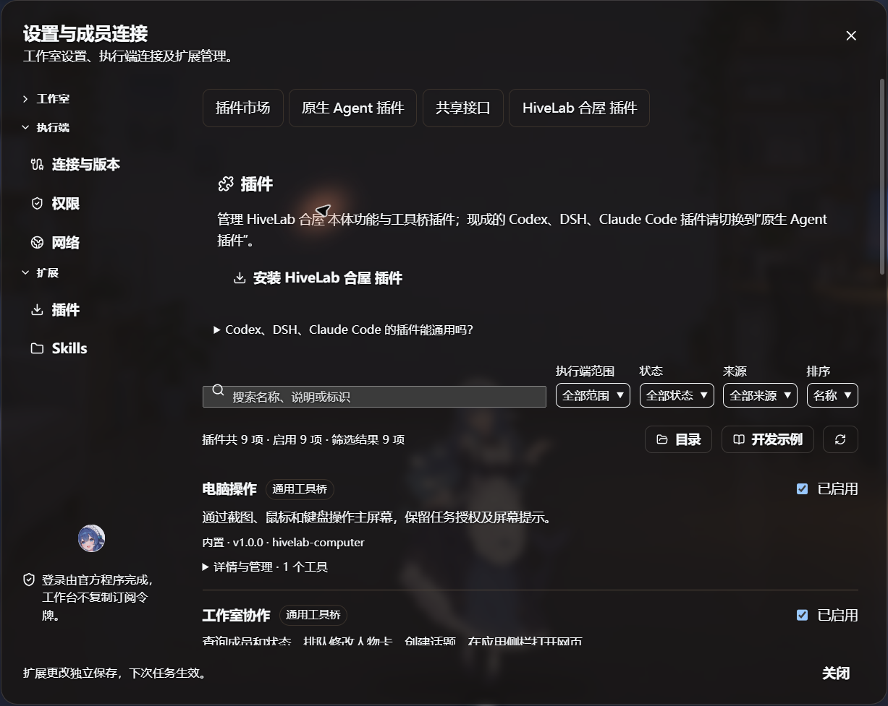

*插件管理：浏览内置插件。*

---

## 外观、动效与语言

**设置 → 外观** 里的修改即时生效，并自动保存在本机。

| 项目 | 可调内容 |
| --- | --- |
| 主题 | 跟随系统、白天、夜晚；主题色可以全局统一，也可以按工位使用人物特征色 |
| 页面背景 | 首页、茶歇室、圆桌、每个工位、每个项目、每份汇报都可以单独设置图片、视频或壁纸，并调节暗化、模糊和铺满方式 |
| Wallpaper Engine | 导入图片、视频、场景和网页壁纸（WebWallGL 本地渲染，沙箱运行，不支持应用程序壁纸） |
| 液态玻璃 | 模糊、折射强度、折射圈厚度、对比度、亮度、饱和度、按压动效，共 7 项参数 |
| 聊天外观 | 回复、我的消息、输入框的颜色和透明度，可以按页面单独设置 |
| 透明度 | 顶栏、左侧栏、菜单、文件预览与浏览器、终端、欢迎卡片分别调节，可同步到全部界面 |
| 自适应文字 | 根据文字下方的实际背景调整深浅，避免壁纸上的文字看不清 |
| 动效 | 跟随系统、完整、简化、关闭四档；动态壁纸可以单独选择是否跟随系统 |
| 启动动画 | 内置“隧道展开”，也可以换成自己的视频 |

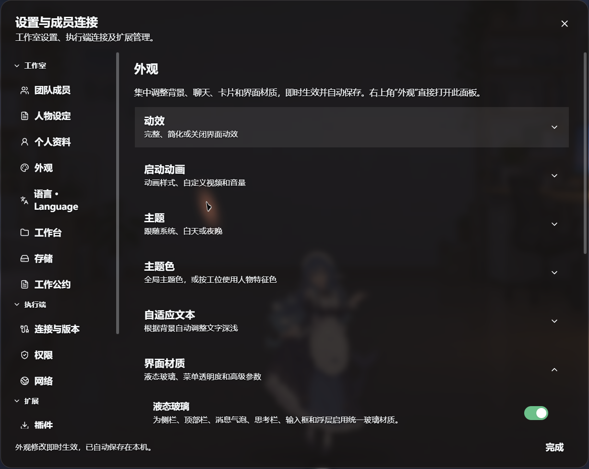

*外观设置：界面材质与页面背景。*

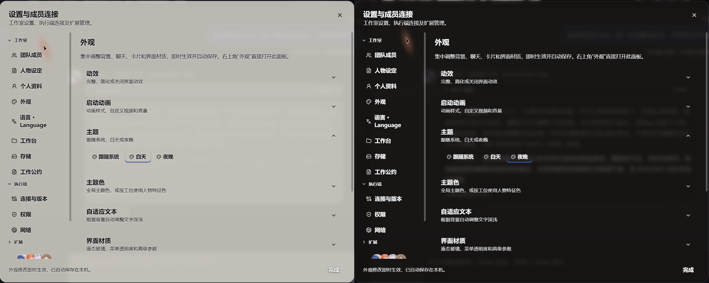

*同一页面的白天与夜晚。*

默认参数：

| 参数 | 默认值 |
| --- | --- |
| 玻璃背景模糊 / 折射强度 / 折射圈厚度 | 1.25 px / 0.9× / 1× |
| 玻璃对比度 / 亮度 / 饱和度 | 1.2× / 0.95× / 0.95× |
| 玻璃按压动效 | 80% |
| 回复、我的消息、输入框透明度 | 70% |
| 顶栏 / 左侧栏透明度 | 95% / 95% |
| 文件预览与浏览器 / 终端 / 欢迎卡片透明度 | 40% / 39% / 40% |
| 菜单透明度 | 26% |
| 主题色 | 雾蓝 `#9bb9ce`，工位使用人物特征色 |
| 启动动画 | 隧道展开，静音 |

### 页面背景与动态壁纸

每个页面（首页、茶歇室、圆桌、每个工位、每个项目、每份成员汇报）都有自己的背景，入口是首页的“背景”或各页面的“本页背景”。

- **图片和视频**：PNG、JPG、WebP、GIF，以及 MP4、WebM、MOV、M4V（视频最大 512 MB，图片最大 32 MB）。导入时会校验文件内容，改了后缀的网页或程序会被拒绝。
- **Wallpaper Engine 壁纸**：在 Wallpaper Engine 里右键壁纸 → 在资源管理器中打开，选择其中的 `project.json`，点“从 Wallpaper Engine 导入”（需要完整的壁纸目录，单独一个 `project.json` 没有画面）。
  - 图片和视频壁纸按普通媒体处理；场景壁纸由内置的 WebWallGL 在本地 WebGL2 里渲染，网页壁纸在沙箱里加载本地页面；应用程序类壁纸不会被执行。
  - 导入时把壁纸目录复制到 HiveLab 自己的资料目录，不改 Steam 里的原文件；单个壁纸最多 1 GB、1 万个文件。
  - 壁纸只能在隔离的沙箱里运行，不提供账号接口和外网连接；网页壁纸需要的外部资源不会加载。
- **播放控制**：动态壁纸默认静音、最高 30 帧，可以手动暂停；离开页面时销毁对应壁纸，窗口隐藏时自动暂停。每个页面还可以单独选择是否“跟随系统减少动态效果”：关闭后，即使系统关了动画，这个页面也照常播放动态背景。
- **显示方式**：暗化、模糊、铺满或完整显示都按页面单独调节；加载失败时自动回到默认的工作室背景。
- **首页开场**：首页背景换了以后，启动动画“隧道展开”会自动用新的背景，不需要另外上传。

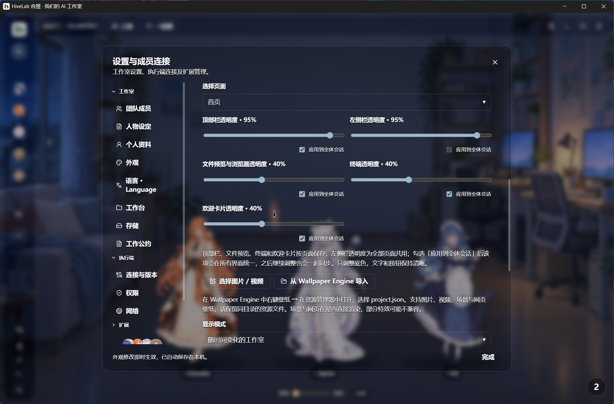

*页面背景设置：选择图片、视频或从 Wallpaper Engine 导入*

### 界面语言

**设置 → 语言 · Language** 可以在“中文（简体中文）”和 English 之间切换，点选后整窗做一次短暂的交叉淡入，设置窗口、正在编辑的内容和滚动位置都保留。

- 语言保存在本机设置里，重启后保持；默认中文，现有用户不受影响。
- 托盘菜单和窗口标题也跟随语言。
- 只影响界面。成员用什么语言回复由人物设定和对话决定，发给成员的提示词保持中文。
- 成员名、话题名、你写的人设和记忆、聊天正文都是你的数据，不会被翻译。

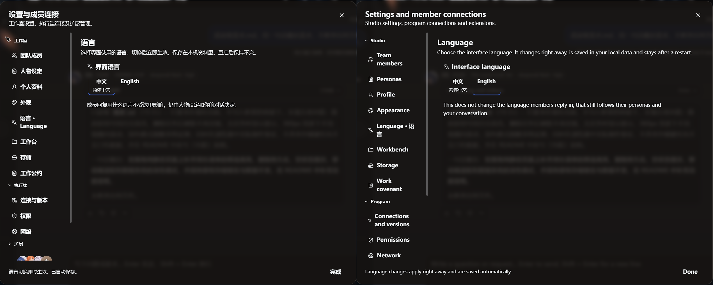

*同一页面的中文与 English 界面。*

### 动效演示

[](docs/media/v01-startup.mp4)

*启动动画“隧道展开”：从标志展开到壁纸，随后界面与成员入场。· [查看高清 MP4](docs/media/v01-startup.mp4)*

[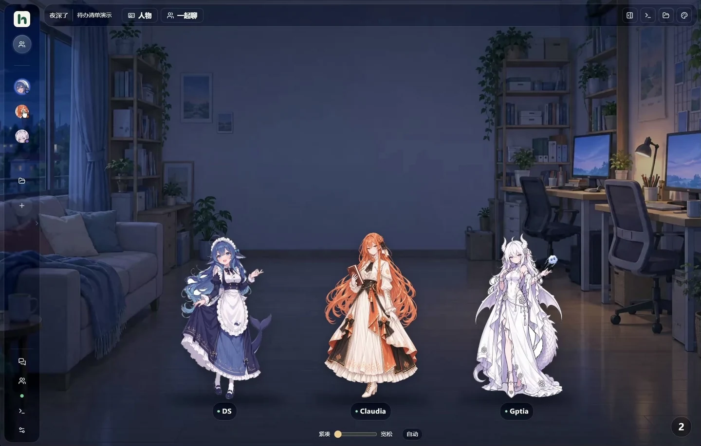](docs/media/v02-page-turn.mp4)

*页面翻页：在不同成员工位间切换，壁纸随页面移动，输入框保持在底部。· [查看高清 MP4](docs/media/v02-page-turn.mp4)*

[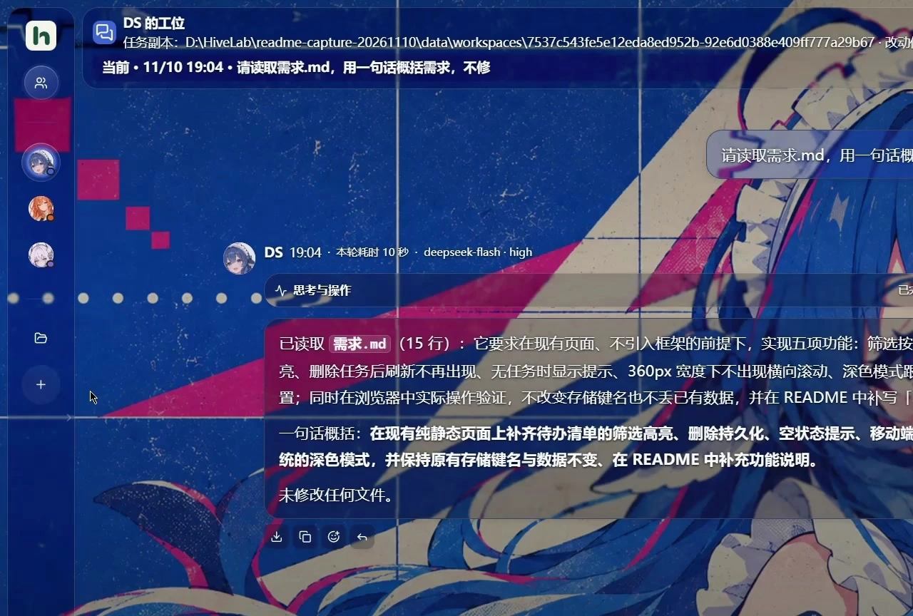](docs/media/v03-sidebar-panels.mp4)

*侧栏弹簧动效：展开、收起与拖动宽度（局部特写）。· [查看高清 MP4](docs/media/v03-sidebar-panels.mp4)*

[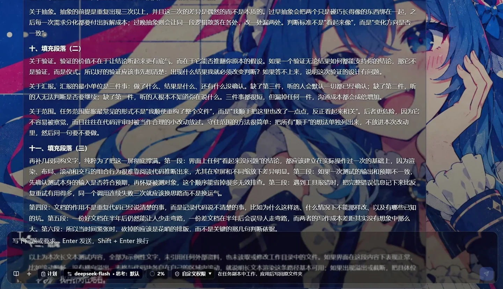](docs/media/v04-liquid-glass.mp4)

*液态玻璃：内容滚动时，输入框保持固定，呈现玻璃模糊与通透层次（局部特写）。· [查看高清 MP4](docs/media/v04-liquid-glass.mp4)*

---

## 任务运行与提醒

**设置 → 工作台** 控制任务怎么跑。提醒开关立即生效；其余项点“保存设置”后生效，成员正在工作时设置会排队，等成员空闲后应用。

| 项目 | 说明 | 默认 |
| --- | --- | --- |
| 成员完成或需要你时通知我 | 任务完成、等待回答或授权、发生错误时提醒：前台显示消息卡片，后台弹出系统通知并闪烁任务栏图标，点击进入对应对话。只影响这台电脑 | 开 |
| 同时执行的任务数量 | 并行任务会共用各成员账号的额度 | 3 |
| 单个任务最长运行时间（分钟） | 0 表示不限时长（含等待审批）；设为正数则到期请求停止并核对执行状态 | 不限 |
| 停止等待时间（秒） | 超时后停下这一轮并清理残留程序，结果标为“待核对” | 10 秒 |
| 新会话默认允许修改文件 | 写入任务使用独立工作区，已有会话的权限不变 | 开 |

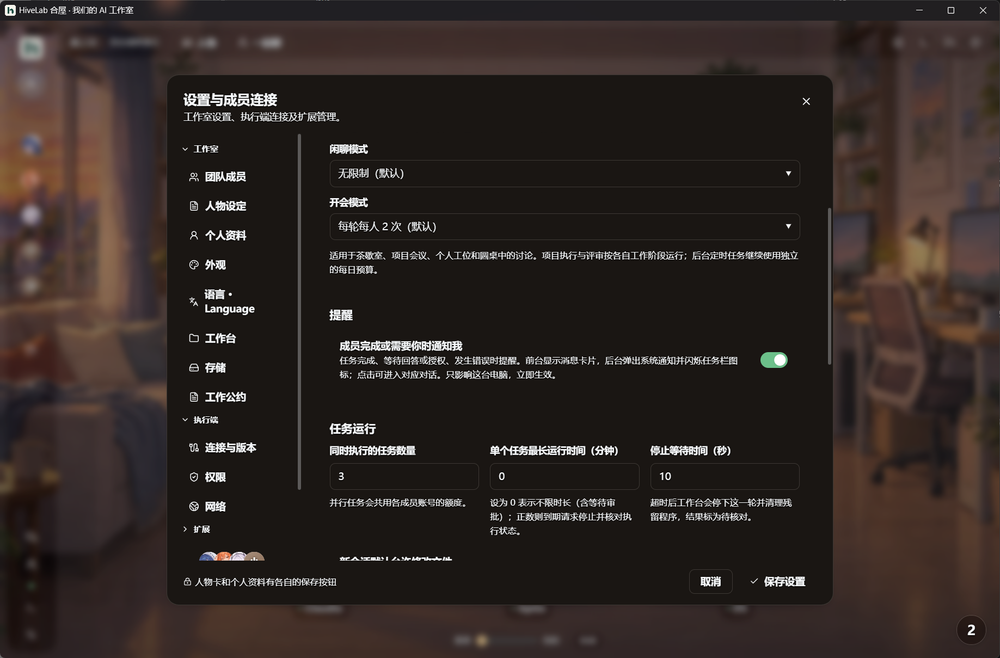

*工作台设置：提醒、并行任务数和任务时限*

---

## 权限与安全

**三档权限：**

| 模式 | 含义 |
| --- | --- |
| 完全访问 | 可以访问工作区外的文件和网络，操作不再逐项询问 |
| 帮我批准 | 在工作区内工作，自动审查可处理的操作，其余交给你确认 |
| 请求批准 | 在工作区内工作，需要扩大权限时由你批准 |

权限可以按人物设置，也可以在工位输入框旁随时调整，从下一轮生效。

**安全设计：**

- 工作副本用于核对差异和回退，但**不是**操作系统级隔离。完全访问模式下，成员程序仍可能修改副本以外的文件。
- 写回前对比文件指纹，发现冲突就停下来列给你，不会覆盖。写回前保存原始字节，所以可以撤销。
- 路径校验覆盖每一级目录，防止符号链接或目录联接把写入带到外面。
- 密钥由系统加密保存，不进入数据库、日志和界面快照；日志和诊断导出都经过脱敏。
- 界面进程开启上下文隔离和沙箱，只能调用白名单内的方法。
- 成员程序由进程管理器启动，放入 Windows Job Object，退出时连同子进程一起结束。
- 随时可以停止：输入框旁的终止、成员级中止，以及托盘的“停止所有成员”。

---

## 资料与备份

- 默认资料目录是 `%USERPROFILE%\.hivelab\data`，可用环境变量 `HIVELAB_DATA_DIR` 修改。
- **备份**：在 **设置 → 存储** 点“立即备份资料”。备份包含数据库、人物图片和附件，不含登录凭据、密钥、程序版本和工作副本。只保留最新一份，新备份校验成功后才删除旧的。
- **恢复**：先点“预览备份”，再准备恢复并确认替换。替换前会再备份一次当前资料，失败时自动回退；恢复后自动功能保持暂停，需要你核对后重新开启。
- 用户插件、Skills 和原生插件目录不在聊天资料备份内，迁移时需要单独复制。
- **空间占用与清理**：**设置 → 存储** 按类别显示占用比例（聊天记录、工位文件、执行端程序、壁纸与背景视频、启动动画、日志、旧数据库备份等），并提供清理入口，所有操作立即执行：
  - 删除 30 天前的日志（数据库里另有事件记录，不影响聊天和任务记录）；
  - 删除升级或迁移留下的旧数据库副本（它们是回退点，确认不再需要再删）；
  - 清理已结束任务留下的目录，运行中成员正在使用的临时文件不会被删；
  - 卸载不用的成员程序版本，只移除程序文件，人物卡、连接、登录配置和聊天记录保留，需要时可在“连接与版本”重新下载；
  - 按话题清理，删除时可选择是否同步删除会话内的文件，默认保留文件；
  - 一键打开数据目录、日志文件夹和成员个人文件夹。

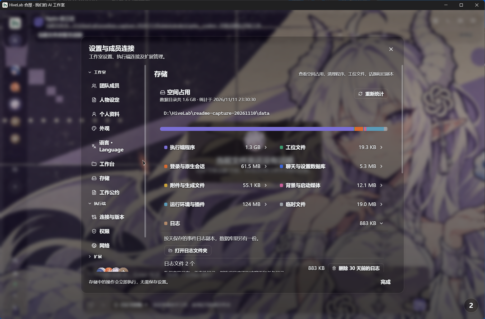

*存储设置：空间占用比例与清理入口*

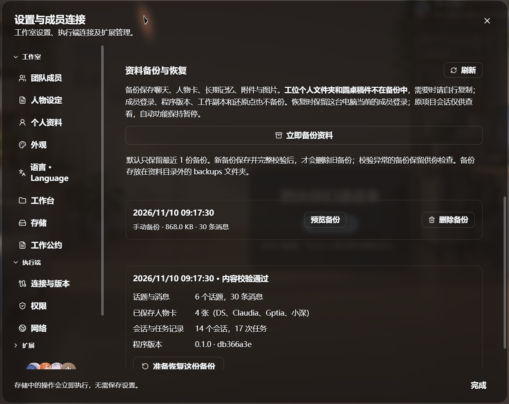

*资料备份与内容预览。*

---

## 开发与构建

### 架构

```text
Electron 主进程 (src/main)            窗口、托盘、方法白名单、密钥、文件预览
   │  MessagePort
执行服务 utilityProcess (src/backend)  调度、讨论、项目流程、圆桌、存储、成员程序适配器
   │  快照差量推送 + invoke 请求
界面 React (src/renderer)              各房间、设置与弹窗
共用 (src/shared)                      类型、协议、请求名单、纯函数
```

| 层 | 选型 |
| --- | --- |
| 桌面外壳 | Electron 44 |
| 界面 | React 19、TypeScript、手写 CSS |
| 数据库 | SQLite（Node 内置 `node:sqlite`，WAL 模式） |
| 构建 | esbuild、Vite、electron-builder |
| 测试 | `node:test`、Playwright |

### 常用命令

| 命令 | 作用 |
| --- | --- |
| `npm run dev` | 构建并以开发模式启动 |
| `npm run typecheck` | 类型检查 |
| `npm test` | 单元与集成测试 |
| `npm run verify` | 完整验证：类型检查、全部测试、界面冒烟、构建、桌面冒烟 |
| `npm run deploy` | 更新本机日常版（需先从托盘退出），加 `-- -Backup` 先备份资料 |
| `npm run package` | 生成安装包和便携包 |
| `npm run package:green` | 生成免安装 ZIP（要求工作区已提交） |
| `npm run package:signed` | 生成带签名的分发包，需要先配置证书 |

所有测试都使用临时的、未登录的资料目录，不会碰日常资料，也不会调用真实模型。新增的界面文字必须同时提供英文词条，缺少时测试会失败。

### 文档

| 文档 | 内容 |
| --- | --- |
| [技术说明](docs/technical.md) | 架构、模块、数据存储、构建和测试 |
| [AI 协作开发指南](docs/development.md) | 用 AI 助手修改和部署 HiveLab，以及项目约定 |
| [后台结构](docs/backend-structure.md) · [界面分层](docs/ui-layers.md) | 模块边界和层级规则 |
| [多连接](docs/catalog-connections.md) · [API 话题模型](docs/api-chat-models.md) | 连接与模型 |
| [插件](docs/extensions.md) · [原生插件](docs/native-plugins.md) · [Skills](docs/skills.md) | 扩展机制 |
| [壁纸](docs/wallpaper-backgrounds.md) · [启动动效](docs/startup-animation.md) | 外观 |
| [运行诊断](docs/runtime-diagnostics.md) · [任务与技能依据](docs/task-and-skill-evidence.md) | 诊断与依据 |
| [贡献指南](CONTRIBUTING.md) · [安全政策](SECURITY.md) · [行为准则](CODE_OF_CONDUCT.md) · [更新记录](CHANGELOG.md) | 参与项目 |

---

## 已知限制

- 目前只在 Windows 上完整验证。仓库里有 macOS（arm64）的打包配置和基础检查，但尚未完成实机运行验证。
- 工作副本不是系统级隔离，见[权限与安全](#权限与安全)。
- 未签名的程序首次运行时可能出现“Windows 已保护你的电脑”提示。
- 英文界面下，运行诊断、部分引擎状态、插件安装说明、备份恢复和主进程对话框等由后台生成的文字仍显示中文；发给成员的提示词始终是中文。
- 计划模式只支持 Claude、Codex 和 DeepSeek Harness；子代理只支持 Claude、Codex、DeepSeek Harness、添加的 Claude 连接和 Antigravity。
- 会议讨论时只读查看项目文件目前支持 Claude、Codex、DeepSeek、GLM，Kimi、Cursor、Qoder 暂不支持。
- ZCode（GLM）的命令运行记录暂时无法核对，相关依据会标为“未核实”。
- 生成和修改图片需要使用 Codex 且允许联网的成员。
- PPTX 和 XLSX 的预览只是内容预览；`edit_file` 不能修改它们。旧版 DOC/XLS/PPT、RTF、OpenDocument、PSD、压缩包等没有内置预览，成员读取时会提示先另存为新格式。
- 高分辨率视频壁纸（如 4K）使用软件解码，CPU 占用可能增加。
- Wallpaper Engine 场景由独立的兼容渲染器绘制，部分特效可能有差异；不支持应用程序壁纸，网页壁纸不能加载外部网络资源。
- 调用次数不等于账单，真实的额度和费用以官方程序返回的数据为准。

---

## 致谢与素材说明

HiveLab 合屋基于 [tonyAmadeus/offAice](https://github.com/tonyAmadeus/offAice) 继续开发。液态玻璃折射改编自 [liquid-glass-web](https://github.com/xiaofangstudio/liquid-glass-web) 和 [Shu Ding 的 liquid-glass](https://github.com/shuding/liquid-glass)。终端使用 xterm.js 和 node-pty，PDF 预览使用 PDF.js，动态壁纸使用 WebWallGL。

内置的 Claude、Codex、DeepSeek 三位成员的立绘来自画师 ZipZipPipe 的作品（[Pixiv 原帖](https://www.pixiv.net/artworks/148186519)、[作者主页](https://www.pixiv.net/users/18604994)），使用时请保留署名，不可商用。

Claude、Codex、DeepSeek、Gemini、Antigravity 等名称属于各自的所有者，HiveLab 与它们没有隶属或背书关系，只是驱动用户自己安装的官方程序。

## 许可

源代码使用 [MIT 许可证](LICENSE)。人物立绘（`src/renderer/assets/`）和 `docs/media/` 里的截图与动效不在其内：立绘需要署名、不可商用，详见 [ATTRIBUTION.md](ATTRIBUTION.md)，第三方软件声明见 [public/third-party-licenses.txt](public/third-party-licenses.txt)。
